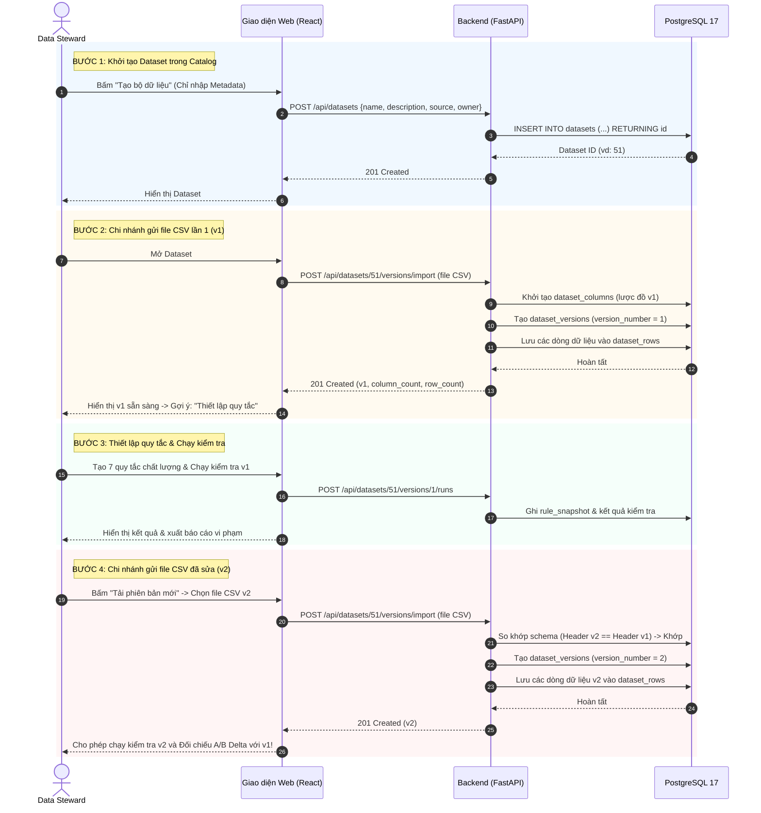

# HM-01: Tách việc tạo Dataset khỏi thao tác upload CSV
## Tài liệu Thiết kế Kỹ thuật và Luồng Nghiệp vụ (Data Catalog Design)

**Dự án:** DataGuard SME (phát triển từ DataLens DQ / DataCheck)  
**Tác giả:** Senior Backend Engineer, Database Architect & Business Analyst  
**Phiên bản:** 1.0.0  
**Trạng thái:** Thiết kế & Đánh giá tác động (Chưa sửa mã nguồn)  
**Ngày lập:** Tháng 11/2026  

---

## 1. Bối cảnh và Mục tiêu kiến trúc

### 1.1. Hiện trạng
Trước đây (trong phiên bản DataLens DQ ban đầu), thao tác tạo Dataset bị gắn chặt với việc nạp dữ liệu:
* Người dùng chỉ có thể tạo một Dataset bằng endpoint `POST /api/datasets/import`, gửi đồng thời file CSV và metadata (`name`, `description`, `source`, `owner`) dưới dạng `multipart/form-data`.
* Trên giao diện, form tạo bộ dữ liệu (`UploadDialog.tsx`) xem thông tin metadata là "bản nháp" và chỉ ghi vào cơ sở dữ liệu khi người dùng xác nhận lưu file CSV đầu tiên.

### 1.2. Vấn đề nghiệp vụ
Trong bài toán Data Catalog chuẩn của DataGuard SME:
* **Khởi tạo danh mục trước:** Người quản trị hoặc Data Steward cần tạo danh mục nghiệp vụ trước (ví dụ: *Bộ dữ liệu Báo cáo Doanh thu Chi nhánh*, phân công người phụ trách, mô tả ý nghĩa nghiệp vụ) trước khi các chi nhánh gửi file CSV về.
* **Tách bạch trách nhiệm:** Bước khai báo danh mục thuộc về quản trị metadata (Metadata Management); bước nạp file thuộc về quản lý phiên bản dữ liệu (Version Control & Ingestion).
* **Độc lập luồng:** Tách việc tạo Dataset thành một thao tác độc lập, sau đó cho phép nạp phiên bản đầu tiên ($v1$) và các phiên bản tiếp theo ($v2, v3, \dots$) qua cùng một kênh nạp phiên bản chuẩn hóa.

---

## 2. Xác minh Schema Cơ sở dữ liệu (Database Schema Verification)

### 2.1. Phân tích các ràng buộc trong PostgreSQL
Dựa trên kiểm tra mã nguồn tại [backend/app/models.py](file:///d:/UserFile/DNCN/Webb/backend/app/models.py#L47-L105) và [backend/migrations/versions/0001_csv_storage.py](file:///d:/UserFile/DNCN/Webb/backend/migrations/versions/0001_csv_storage.py#L24-L75):

1. **Bảng `datasets`:**
   * Cột: `id` (PK), `name` (TEXT NOT NULL), `description` (TEXT nullable), `source` (TEXT nullable), `owner` (TEXT nullable), `created_at` (TIMESTAMPTZ), `updated_at` (TIMESTAMPTZ).
   * Ràng buộc: Duy nhất ràng buộc `CheckConstraint("name ~ '[^[:space:]]'", name="ck_datasets_name_nonblank")` để đảm bảo tên không rỗng hoặc chỉ toàn khoảng trắng.
   * **Kết luận:** Bảng `datasets` **KHÔNG CÓ** bất kỳ khóa ngoại (FK), trigger hay CHECK constraint nào bắt buộc phải có bản ghi con tương ứng trong `dataset_versions` hoặc `dataset_columns`.

2. **Quan hệ phụ thuộc (Child-to-Parent Foreign Keys):**
   * `dataset_columns.dataset_id` $\rightarrow$ `datasets.id` (FK)
   * `dataset_versions.dataset_id` $\rightarrow$ `datasets.id` (FK)
   * `quality_rules.dataset_id` $\rightarrow$ `datasets.id` (FK)
   * `dataset_rows.version_id` $\rightarrow$ `dataset_versions.id` (FK)
   * `quality_runs.dataset_version_id` $\rightarrow$ `dataset_versions.id` (FK)
   * `quality_violations.run_id` $\rightarrow$ `quality_runs.id` (FK)

### 2.2. Kết luận kiến trúc DB
> [!IMPORTANT]
> **Cơ sở dữ liệu PostgreSQL (Alembic Head `0008`) HOÀN TOÀN ĐÃ HỖ TRỢ một Dataset rỗng (chưa có version, chưa có column).**  
> Không cần tạo thêm bất kỳ database migration nào (Zero DB Migration) cho HM-01. Mọi thay đổi hoàn toàn nằm ở tầng API, Service Logic và Giao diện người dùng.

---

## 3. Thiết kế API và Hợp đồng Dữ liệu (API Contract)

### 3.1. API Tạo Dataset độc lập (Mới)

* **Phương thức & Đường dẫn:** `POST /api/datasets`
* **Xác thực & Bảo mật:**
  * Bắt buộc có phiên đăng nhập hợp lệ (`require_business_access` via `datalens_session` cookie).
  * Kiểm tra Origin allowlist (`http://127.0.0.1:5173`).
  * Bắt buộc gửi kèm `X-CSRF-Token` trong header (CSRF in-memory token của phiên).
* **Mã trạng thái thành công:** `201 Created`
* **Request Headers:**
  ```http
  Content-Type: application/json
  X-CSRF-Token: <session_csrf_token>
  Origin: http://127.0.0.1:5173
  ```
* **Request Body Schema (Pydantic):**
  ```python
  class DatasetCreate(BaseModel):
      model_config = ConfigDict(extra="forbid")
      name: StrictStr
      description: StrictStr | None = None
      source: StrictStr | None = None
      owner: StrictStr | None = None
  ```
* **Quy tắc xác thực (Validation Rules):**
  * `name`: Bắt buộc, không được chỉ chứa khoảng trắng, độ dài tối đa 200 Unicode code points, không chứa ký tự NUL (`\x00`).
  * `description`, `source`, `owner`: Tùy chọn, độ dài tối đa 200 Unicode code points nếu có, không chứa ký tự NUL.
* **Response Body (`201 Created`):**
  ```json
  {
    "id": 51,
    "name": "Danh mục Khách hàng Doanh nghiệp",
    "description": "Quản lý metadata thông tin khách hàng từ chi nhánh",
    "source": "Khối Khách hàng Doanh nghiệp",
    "owner": "Nguyễn Văn A",
    "created_at": "2026-11-03T07:45:00+00:00",
    "updated_at": "2026-11-03T07:45:00+00:00"
  }
  ```
* **Mã lỗi quy chuẩn:**
  * `401 UNAUTHENTICATED`: Chưa đăng nhập hoặc phiên hết hạn.
  * `403 CSRF_FAILED`: Sai hoặc thiếu CSRF token.
  * `422 INVALID_METADATA`: Tên rỗng, tên chỉ có khoảng trắng, hoặc chứa ký tự NUL.
  * `422 EXTRA_FIELDS`: Có trường thừa không được phép.
  * `503 DATABASE_UNAVAILABLE`: Không thể kết nối cơ sở dữ liệu.

---

### 3.2. Nâng cấp API nạp phiên bản (`POST /api/datasets/{dataset_id}/versions/import`)

Hiện tại, tại [backend/app/services/dataset_import.py#L18-L20](file:///d:/UserFile/DNCN/Webb/backend/app/services/dataset_import.py#L18-L20), hàm `import_version` đọc `header` hiện tại của dataset. Nếu dataset chưa có cột (`header == []`), việc so sánh `if parsed.header != header:` sẽ báo lỗi `CSV_SCHEMA_MISMATCH`.

**Logic xử lý mới khi import version:**
```python
def import_version(dataset_id: int, parsed: ParsedCSV, filename: str) -> dict:
    inferred = infer_types(parsed.header, parsed.rows)
    with rule_connection() as connection:
        if connection.execute(select(Dataset.id).where(Dataset.id == dataset_id).with_for_update()).first() is None:
            raise CatalogNotFound()
        
        # 1. Đọc danh sách cột hiện có
        existing_columns = connection.execute(
            select(DatasetColumn.name)
            .where(DatasetColumn.dataset_id == dataset_id)
            .order_by(DatasetColumn.position)
        ).scalars().all()

        if not existing_columns:
            # TRƯỜNG HỢP 1: Dataset rỗng (Chưa có phiên bản nào)
            # Khởi tạo lược đồ cột ban đầu từ file CSV phiên bản v1
            connection.execute(insert(DatasetColumn), [
                {"dataset_id": dataset_id, "name": name, "position": position}
                for position, name in enumerate(parsed.header, 1)
            ])
            header = parsed.header
            version_number = 1
        else:
            # TRƯỜNG HỢP 2: Dataset đã có cấu trúc cột (v2, v3, ...)
            # Bắt buộc cấu trúc file gửi lên phải khớp 100% với cấu trúc đã định nghĩa
            if parsed.header != existing_columns:
                raise CSVValidationError(
                    'CSV_SCHEMA_MISMATCH',
                    'Tên và thứ tự cột phải khớp bộ dữ liệu. Hãy tạo bộ dữ liệu khác nếu cấu trúc thay đổi.'
                )
            header = existing_columns
            max_ver = connection.execute(
                select(func.max(DatasetVersion.version_number))
                .where(DatasetVersion.dataset_id == dataset_id)
            ).scalar_one() or 0
            version_number = max_ver + 1

        # 2. Tạo bản ghi DatasetVersion
        version_id = connection.execute(
            insert(DatasetVersion).values(
                dataset_id=dataset_id,
                version_number=version_number,
                original_filename=filename,
                file_size_bytes=parsed.file_size_bytes,
                row_count=parsed.row_count,
                inferred_types=inferred,
            ).returning(DatasetVersion.id)
        ).scalar_one()

        # 3. Nạp DatasetRow theo batch 1000 dòng
        for start in range(0, parsed.row_count, 1000):
            connection.execute(insert(DatasetRow), [
                {'version_id': version_id, 'row_number': index + 1, 'values': parsed.rows[index]}
                for index in range(start, min(start + 1000, parsed.row_count))
            ])
            
        # 4. Cập nhật updated_at cho Dataset
        connection.execute(
            update(Dataset)
            .where(Dataset.id == dataset_id)
            .values(updated_at=datetime.now(timezone.utc))
        )

        return {
            'dataset_id': dataset_id,
            'version_id': version_id,
            'version_number': version_number,
            'column_count': len(header),
            'row_count': parsed.row_count
        }
```

---

### 3.3. Bảo toàn API nạp cũ (`POST /api/datasets/import`)
Endpoint `POST /api/datasets/import` (upload CSV tạo đồng thời Dataset + v1) được **GIỮ NGUYÊN HOÀN TOÀN** để đảm bảo tính tương thích ngược (Backward Compatibility) với các script kiểm thử tự động hiện có (`verify-redesign.py`, `test_dataset_import.py`).

---

## 4. Hành vi của Dataset Rỗng trên toàn bộ hệ sinh thái API

Khi một Dataset tồn tại ở trạng thái chưa nạp file nào:

| Endpoint | Hành vi thiết kế cho Dataset rỗng | Mã trả về |
| :--- | :--- | :--- |
| `GET /api/datasets` | Trả về dataset trong danh sách với `version_count: 0`. | `200 OK` |
| `GET /api/datasets/{id}` | Trả về metadata của dataset với `columns: []` và `versions: []`. | `200 OK` |
| `GET /api/datasets/{id}/versions/{version_id}/rows` | Báo không tìm thấy phiên bản (`CatalogNotFound`). | `404 NOT_FOUND` |
| `GET /api/datasets/{id}/rules` | Trả về danh sách quy tắc rỗng: `{"items": [], "total": 0, "page": 1, "page_size": 20}`. | `200 OK` |
| `POST /api/datasets/{id}/rules` | Chặn tạo quy tắc vì chưa có cột nào: báo lỗi `INVALID_HEADER` (*Header phải có tên cột hợp lệ, không trùng*). | `422 Unprocessable` |
| `GET /api/datasets/{id}/runs` | Trả về danh sách lần chạy rỗng: `{"items": [], "total": 0, "page": 1, "page_size": 20}`. | `200 OK` |
| `POST /api/datasets/{id}/versions/{version_id}/runs` | Không thể gọi vì chưa có `version_id`. Nếu gửi `version_id` bất kỳ sẽ báo lỗi 404. | `404 NOT_FOUND` |
| `GET /api/datasets/{id}/quality-trend` | Trả về trend rỗng: `{"dataset_id": id, "points": [], "total_completed": 0, ...}`. | `200 OK` |
| `POST /api/datasets/{id}/ai-rule-suggestions/preview` | Báo lỗi 404 vì yêu cầu `version_id` phải tồn tại. | `404 NOT_FOUND` |

---

## 5. Thiết kế Luồng Nghiệp vụ Người dùng (User Journey)



---

## 6. Bảo toàn Tính toàn vẹn và Bất biến của Engine & Snapshot

1. **Quality Engine v5:** Tuyệt đối không thay đổi. Việc tạo Dataset rỗng không ảnh hưởng đến logic thực thi chất lượng bên trong worker RE2 hay các quy tắc kiểm tra.
2. **Rule Snapshot:** Khi chạy kiểm tra, snapshot chỉ được chụp từ các quy tắc active gắn với `dataset_id` tại thời điểm chạy cho một `dataset_version_id` cụ thể. Dataset rỗng không có version nên không thể chạy kiểm tra, đảm bảo không có snapshot rỗng nào được sinh ra.
3. **Run Comparison & Fingerprint:** Giữ nguyên 100% thuật toán băm fingerprint và delta comparison.

