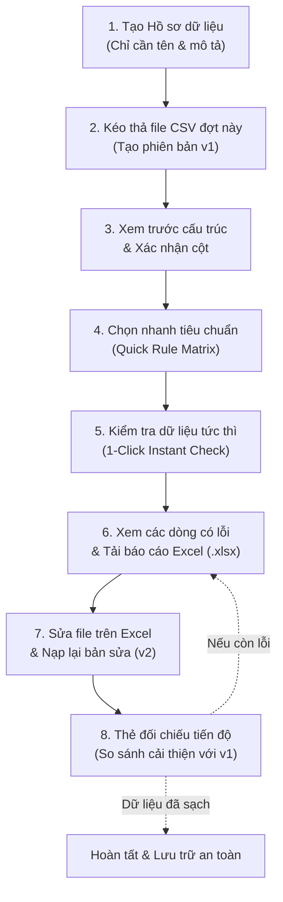

# THIẾT KẾ LUỒNG NGƯỜI DÙNG CHI TIẾT (USER FLOW SPECIFICATION)
## HỆ THỐNG DATAGUARD SME

**Dự án:** DataGuard SME (phát triển từ DataLens DQ / DataCheck)  
**Hạng mục:** HM-02B: User Flows & Interaction Models  
**Thời gian lập:** 03/11/2026  
**Vai trò:** Senior Product Designer, UX Architect & Business Analyst  

---

## 1. Luồng khép kín cốt lõi (End-to-End Task Flow)

Luồng kiểm soát chất lượng dữ liệu của DataGuard SME được chuẩn hóa thành chu trình 7 chặng liên hoàn, tối ưu cho người làm việc với bảng tính Excel:



---

## 2. Chi tiết từng bước tương tác trong Dataset Workspace

### Bước 1: Khởi tạo Hồ sơ dữ liệu (Metadata Creation)
- **Điểm kích hoạt:** Nút "Tạo bộ dữ liệu mới" trên Trang chủ hoặc Danh mục.
- **Hành động người dùng:**
  - Nhập **Tên bộ dữ liệu** (Bắt buộc, tối đa 200 ký tự, ví dụ: *"Danh sách khách hàng SME"*).
  - Nhập **Người phụ trách** (Tùy chọn, ví dụ: *"Nguyễn Thị Mai"*).
  - Nhập **Nguồn dữ liệu / Bộ phận** (Tùy chọn, ví dụ: *"Phòng Kinh doanh"*).
  - Nhập **Mô tả** (Tùy chọn).
- **Phản hồi hệ thống:**
  - Gọi `POST /api/datasets` tạo bản ghi độc lập.
  - Tự động chuyển hướng người dùng đến `#/datasets/{id}/check`.
  - Hiển thị banner chào mừng rỗng: *"Bộ dữ liệu đã sẵn sàng. Hãy nạp file CSV đầu tiên để bắt đầu."*

---

### Bước 2: Nạp file CSV đầu tiên ($v1$)
- **Điểm kích hoạt:** Nút "Tải file CSV đầu tiên" tại tab Kiểm tra dữ liệu.
- **Hành động người dùng:** Kéo thả file `.csv` từ máy tính hoặc bấm "Chọn file từ máy tính".
- **Kiểm tra tức thì tại trình duyệt (Pre-validation client-side):**
  - Đuôi mở rộng phải là `.csv`.
  - Dung lượng file $\le$ 5 MiB (khoảng 10.000 dòng).
  - Định dạng chuẩn UTF-8 hoặc UTF-8 BOM.
  - Báo lỗi ngay nếu file rỗng hoặc thiếu dòng tiêu đề.
- **Hành động tiếp theo:** Hiển thị bản xem trước 10 dòng đầu tiên kèm tóm tắt số cột và số bản ghi.

---

### Bước 3: Xem trước cấu trúc & Xác nhận tạo phiên bản $v1$
- **Giao diện:** Bảng xem trước dữ liệu mẫu (10 dòng đầu), thẻ thông tin số cột, số dòng.
- **Hành động người dùng:** Bấm nút **"Xác nhận lưu file"**.
- **Phản hồi hệ thống:**
  - Gọi `POST /api/datasets/{id}/versions/import`.
  - Backend tự động trích xuất các cột header thành `DatasetColumn`, lưu dữ liệu vào `DatasetRow` và tạo phiên bản `v1`.
  - Giao diện tự động chuyển tiếp mượt mà sang **Bước 4: Thiết lập quy tắc nhanh** mà **không bắt người dùng phải tải lại trang hay mở cửa sổ mới**.

---

### Bước 4: Thiết lập tiêu chuẩn dữ liệu nhanh (Quick Rule Matrix)
- **Giao diện:** Bảng danh sách tất cả các cột được trích xuất từ file.
- **Tương tác dạng ma trận (Checkbox Matrix):**
  Mỗi cột có các tùy chọn nhanh:
  - ☑️ **Bắt buộc điền:** Không cho phép ô trống hoặc khoảng trắng (`required`).
  - ☑️ **Không trùng lặp:** Mỗi dòng phải có giá trị duy nhất (`unique`).
  - 🔽 **Kiểu dữ liệu:** Menu thả xuống gợi ý: `Văn bản`, `Số nguyên`, `Số tiền / Số thập phân`, `Ngày tháng (YYYY-MM-DD / DD/MM/YYYY)`, `Email`.
  - ➕ **Nâng cao:** Bổ sung khoảng giá trị ($min - max$), danh sách giá trị cho phép hoặc mẫu Regex (chỉ mở khi bấm xem thêm).
- **Hỗ trợ AI thông minh:**
  - Nút **"Gợi ý tiêu chuẩn bằng AI"**: Phân tích tên cột và thống kê, đề xuất danh sách các điều kiện phổ biến kèm lý do bằng tiếng Việt giản dị (Ví dụ: *"Cột 'email' có 98% giá trị chứa ký tự @, gợi ý áp dụng tiêu chuẩn Định dạng Email"*).
  - Người dùng bấm "Chấp nhận tất cả" hoặc tích chọn từng gợi ý $\rightarrow$ Không hiển thị chuỗi JSON thô.
- **Lưu quy tắc:** Bấm "Lưu tiêu chuẩn" $\rightarrow$ Tạo các bản ghi quy tắc qua `POST /api/datasets/{id}/rules`.

---

### Bước 5: Chạy kiểm tra tức thì (Instant Quality Check)
- **Hành động người dùng:** Bấm nút **"Bắt đầu kiểm tra"**.
- **Phản hồi hệ thống:**
  - Gọi `POST /api/datasets/{id}/versions/{v1}/runs`.
  - Hiển thị trạng thái đang xử lý (`status: running`) kèm vòng xoay tiến trình nhẹ nhàng.
  - Hệ thống tự động polling kiểm tra trạng thái mỗi 2 giây. Khi hoàn tất (`status: completed`), giao diện tự động mở rộng vùng kết quả bên dưới mà không làm gián đoạn ngữ cảnh.

---

### Bước 6: Đọc kết quả vi phạm & Xuất file sửa lỗi
- **Bảng tóm tắt chất lượng (Result Card):**
  - **Tỷ lệ hợp lệ:** Ví dụ: `92.5%` (Bản ghi sạch).
  - **Dòng có lỗi:** `15 dòng` (tô màu đỏ cảnh báo).
  - **Tổng số dòng:** `200 dòng`.
  - **Số lượt vi phạm tiêu chuẩn:** `22 lượt` (chú thích rõ: một dòng có thể phạm nhiều lỗi).
- **Bảng chi tiết vi phạm:**
  - Cột 1: **Vị trí trong Excel** (Ghi rõ số dòng theo file Excel để kế toán đối chiếu).
  - Cột 2: **Tên cột & Giá trị vi phạm**.
  - Cột 3: **Tiêu chuẩn vi phạm & Hướng dẫn sửa** (Ví dụ: *"Mã khách hàng bị để trống"* hoặc *"Ngày 30/02/2026 không có trong lịch"*).
  - Nút con mắt: Mở popup xem toàn bộ thông tin của dòng đó.
- **Hành động xuất file:**
  - Nút chính màu xanh lá: **"Tải báo cáo lỗi Excel (.xlsx)"** (Gọi trực tiếp `GET .../report.xlsx` tải file Excel chuyên nghiệp có màu đánh dấu).
  - Nút phụ: "Xuất danh sách lỗi CSV".

---

### Bước 7: Sửa dữ liệu & Nạp lại phiên bản mới ($v2$)
- **Hành động người dùng:**
  - Mở file trong Excel, đối chiếu theo số dòng lỗi đã xuất trong báo cáo và tiến hành sửa dữ liệu.
  - Quay lại hệ thống, bấm nút **"Tải lên bản đã sửa"** ngay tại màn hình kết quả.
  - Chọn file CSV mới đã sửa.
- **Kiểm soát cấu trúc thông minh (Schema Matching & Recovery Flow):**
  - *Trường hợp 1 (Trùng khớp 100%):* Hệ thống thông báo *"Cấu trúc file hợp lệ và khớp với đợt trước"*, tự động tạo $v2$ và kích hoạt kiểm tra lại ngay.
  - *Trường hợp 2 (Lệch cấu trúc - Schema Mismatch):* Nếu file sửa có thêm cột hoặc đổi tên cột, hệ thống hiển thị hộp thoại hỗ trợ đối soát:
    - Liệt kê rõ: Cột thiếu là gì? Cột mới là gì?
    - Hướng dẫn bằng tiếng Việt: *"File mới có 5 cột, nhưng đợt trước có 4 cột. Vui lòng kiểm tra lại file Excel hoặc lưu thành hồ sơ dữ liệu mới nếu cấu trúc nghiệp vụ thay đổi."*

---

### Bước 8: Thẻ đối chiếu tiến độ tự động (Progress Comparison Card)
- **Điểm kích hoạt:** Ngay sau khi đợt kiểm tra của $v2$ hoàn tất.
- **Phản hồi hệ thống:**
  - Tự động gọi API `GET /api/datasets/{id}/run-comparison?a_run_id={v1_run}&b_run_id={v2_run}`.
  - Hiển thị **Thẻ chúc mừng tiến độ (Progress Card)** ở đầu trang:
    ```
    ┌────────────────────────────────────────────────────────────────────────┐
    │ 🎉 TIẾN ĐỘ LÀM SẠCH DỮ LIỆU RẤT TỐT!                                   │
    │ Bạn đã sửa thành công 12/15 dòng lỗi (Giảm 80% lỗi so với đợt v1).     │
    │ Tỷ lệ dữ liệu sạch tăng từ 92.5% lên 98.5% (+6.0 điểm phần trăm).      │
    │ Còn lại: 3 dòng cần xem xét lại trước khi nạp vào hệ thống kế toán.    │
    └────────────────────────────────────────────────────────────────────────┘
    ```
  - Bảng lỗi bên dưới tự động lọc chỉ hiển thị 3 dòng lỗi còn sót lại.

---

## 3. Quản lý trạng thái lỗi & Ngăn ngừa sự cố (Exception Handling)

| Tình huống ngoại lệ | Trải nghiệm hiện tại | Trải nghiệm mới đề xuất (HM-02B) |
|---|---|---|
| **Mất kết nối mạng khi nạp file lớn** | Thông báo lỗi đỏ chung chung: *"Mất kết nối..."* | Hiển thị thông báo lưu giữ bản nháp: *"Đường truyền gián đoạn. File chưa được gửi trọn vẹn tới máy chủ. Bấm Thử gửi lại hoặc kiểm tra kết nối mạng."* |
| **Chạy kiểm tra thất bại do lỗi hệ thống** | Trả mã 500 hoặc 503 với chữ tiếng Anh | Hiển thị thông báo thân thiện: *"Máy chủ đang bận xử lý dữ liệu lớn. Kết quả cũ vẫn an toàn. Bấm 'Thử kiểm tra lại' sau 1 phút."* |
| **Chưa có quy tắc nào đang bật** | Nút Chạy kiểm tra bị disable không rõ lý do | Nút chuyển thành trạng thái hướng dẫn: *"Chọn ít nhất 1 điều kiện kiểm tra trước khi bấm chạy"* kèm mũi tên trỏ vào bảng quy tắc. |
| **Tên bộ dữ liệu bị trùng hoặc rỗng** | Báo lỗi tiếng Anh `INVALID_NAME` | Báo lỗi tiếng Việt tức thì ngay dưới ô nhập: *"Tên bộ dữ liệu không được để trống hoặc chỉ có khoảng trắng."* |

